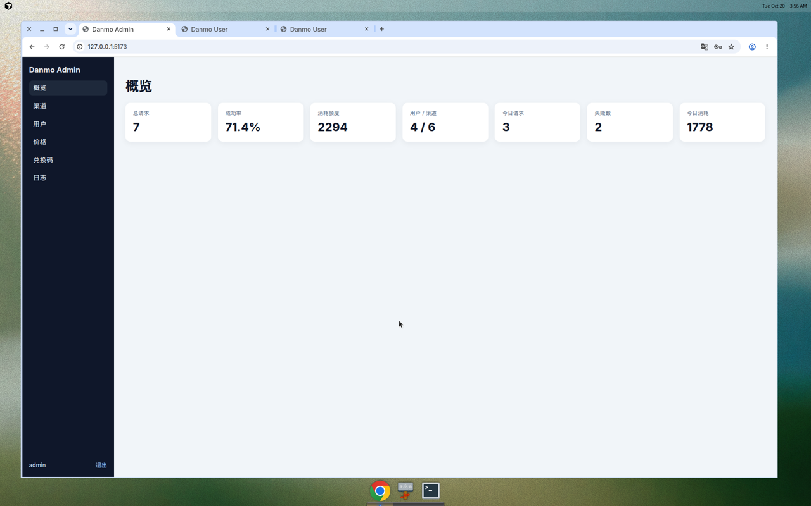
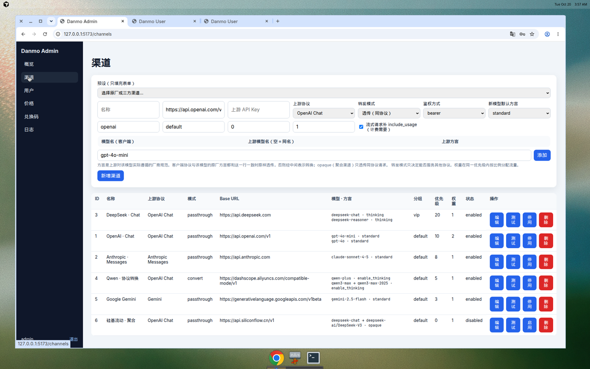
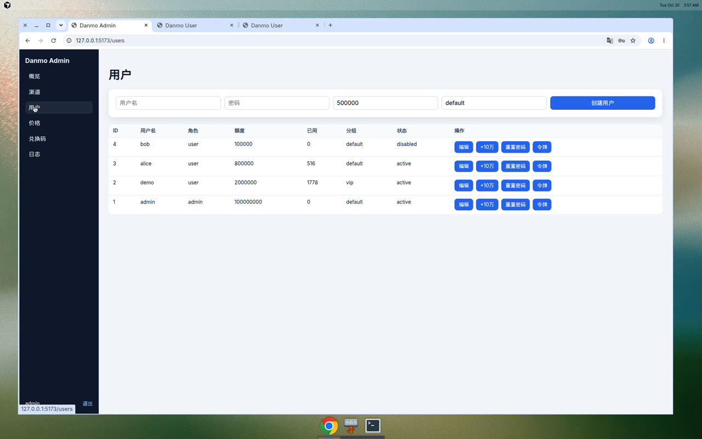
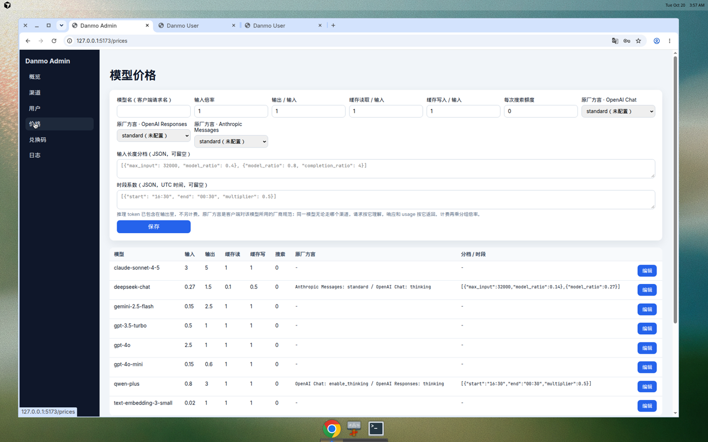
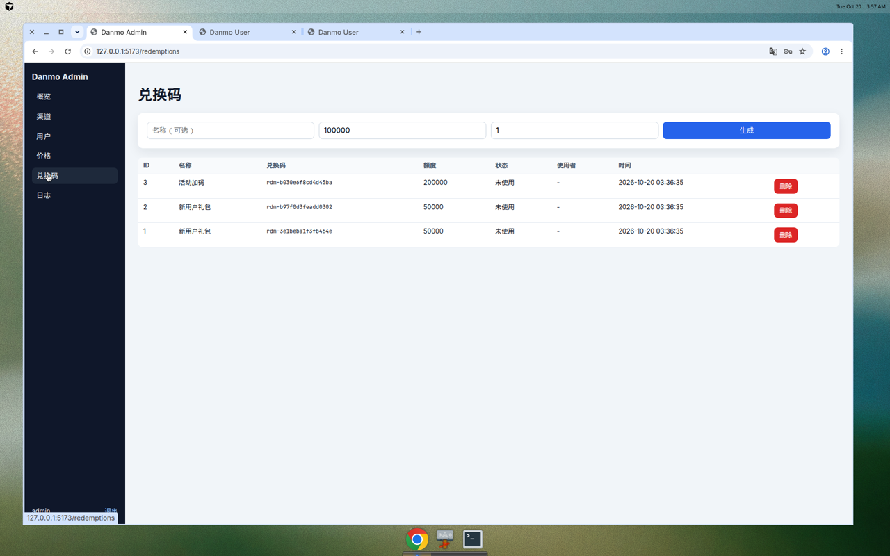
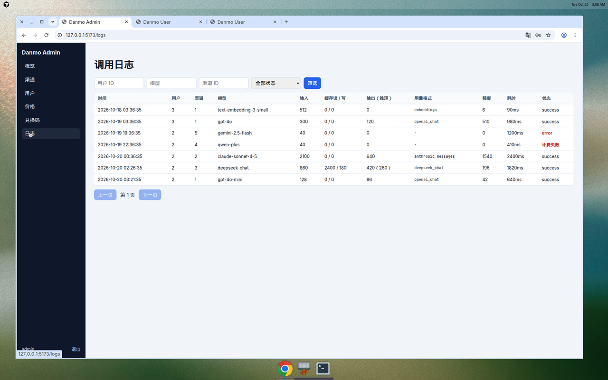
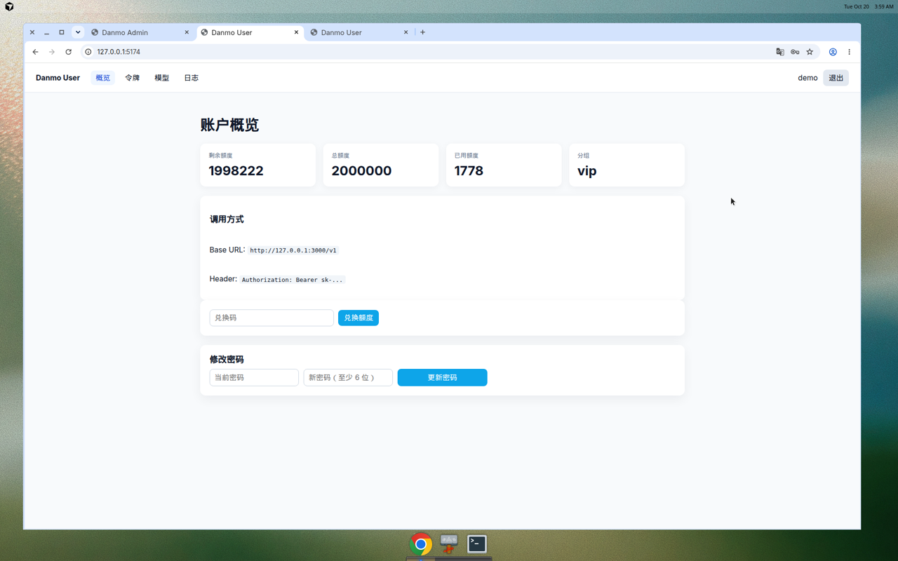
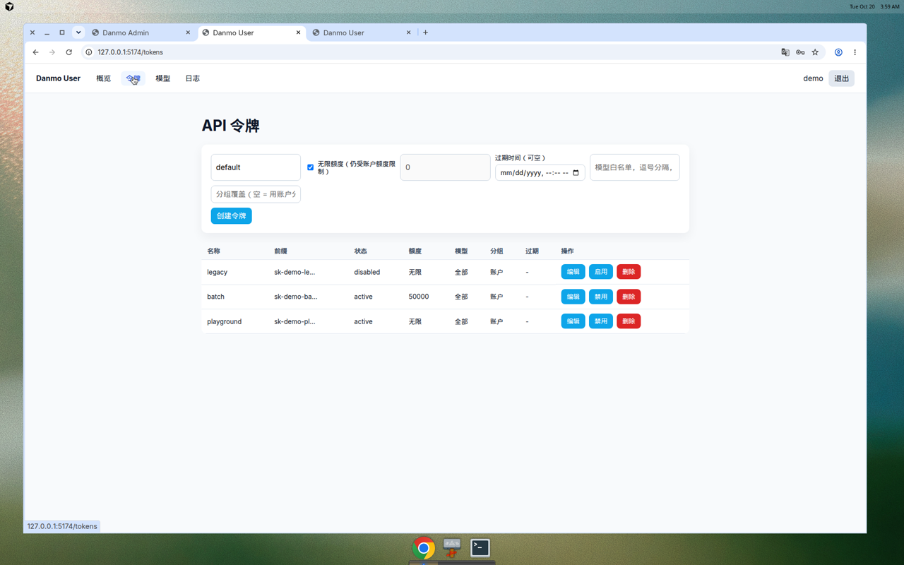
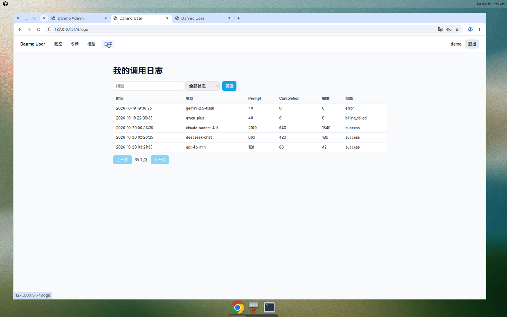

# danmo-router

多协议 LLM 中转站：Chat、Responses、Messages、Gemini、Embeddings 转发，管理 Portal 和用户 Portal。客户端按模型看到的协议行为与原厂一致；渠道按每个模型配置上游方言。

- 系统设计（协议、方言、计费、渠道健康）：[docs/architecture.md](docs/architecture.md)
- **运维手册（自建/云平台部署、配置、升级、备份、排障）：[docs/operations.md](docs/operations.md)**
- 贡献 / Agent 规则（迁移按引擎、install/upgrade）：[AGENTS.md](AGENTS.md)
- 与 One API、New API、LiteLLM、GPT-Load、Sub2API 等的客观对比：[docs/comparison.md](docs/comparison.md)
- **部署前必读** — 合法授权、禁止规避上游协议的中转/转售、责任边界：[docs/compliance.md](docs/compliance.md)

> **合规提示**  
> danmo-router 是面向**合法授权**场景的自托管 API 网关（自用、团队内部、企业私有化部署）。部署方须**合法取得**上游 API Key 或合约，并遵守各 AI 厂商服务条款与所在地法律法规。  
> 不得利用本软件将违反上游条款的订阅/账号池化后对外提供 API、按量转售未授权能力，或以协议转换等方式规避上游对再分发、自动化使用的限制。  
> 面向公众提供生成式 AI 服务时的备案、内容安全、实名、日志、税务等义务由**部署方自行承担**。软件按 MIT「原样」提供，维护者不对部署方的经营行为或滥用后果负责。详见 [docs/compliance.md](docs/compliance.md)。

## 架构

三个可独立部署的二进制（共享同一 `DATABASE_URL`）：

| 二进制 | 默认端口 | 职责 |
|--------|----------|------|
| `danmo-relay` | 3000 | 流量转发（可水平扩容） |
| `danmo-admin` | 3001 | `/api/admin/*` 管理 API |
| `danmo-user` | 3002 | `/api/user/*` 用户 API |
| `danmo-router` | 3000 | 本地一体进程（不建议生产） |

前端：`apps/admin`（5173）、`apps/user`（5174）。

```text
Client ──► LB ──► danmo-relay × N  ──► upstream LLM
Admin UI ──────► danmo-admin × 1..N
User UI  ──────► danmo-user  × 1..N
                      │
                      └── shared DB (SQLite WAL / 后续 Postgres)
```

扩容建议：优先扩 `danmo-relay`；admin/user 通常少量副本即可。多副本写库时请使用支持并发的数据库（当前 SQLite WAL 适合轻量多进程，不适合大量 relay 副本）。渠道上的方言决定请求按哪套厂商规范透传或转换，模型价格上的原厂方言决定客户端看到的字段。

## 界面

管理后台（`http://localhost:5173`，默认 `admin` / `admin123`）：













用户中心（`http://localhost:5174`，示例账号 `demo` / `demo1234`）：








## 转发

入站协议由路径决定。模型价格上的 `native_dialects` 是原厂方言；渠道下每个模型一行，带上游模型名和上游方言。两端协议和方言相同则透传原字节，否则经中间表示转换。`opaque` 行只透传同协议请求。用量按响应字段计费，没有可用字段则退款并记 `billing_failed`。

| 路径 | 协议 |
|------|------|
| `POST /v1/chat/completions` | OpenAI Chat |
| `POST /v1/responses` | OpenAI Responses |
| `POST /v1/messages` | Anthropic Messages |
| `POST /v1/embeddings` | Embeddings |
| `POST /v1beta/models/{model}:generateContent` | Gemini |
| `POST /v1beta/models/{model}:streamGenerateContent` | Gemini 流式 |
| `GET /v1/models` | 模型列表 |

完整的方言列表、转发判定、数据模型和计费公式见 [系统架构](docs/architecture.md)。

## Makefile

```bash
make help           # 查看全部目标
make test           # 测试
make release        # 编译三个拆分二进制 + all-in-one
make run-relay      # 启动转发 :3000
make run-admin      # 启动管理 API :3001
make run-user       # 启动用户 API :3002
make portals-build  # 构建两个 Portal
make package        # 产出 dist/bin + dist/apps
make check          # fmt + clippy + test（对齐 CI）
```

## 本地开发

```bash
cp .env.example .env

# 三个终端
make run-relay
make run-admin
make run-user

# Portal
make portals-install
make portals-dev-admin   # http://localhost:5173 → :3001
make portals-dev-user    # http://localhost:5174 → :3002
```

要在界面里看到渠道、用户和调用记录，把 `.env` 里的 `SEED_DEMO` 设为 `1` 后再启动。详见下一节。

一体进程（调试用）：

```bash
make run-all-in-one
# Portal 需改代理：VITE_API_PROXY=http://127.0.0.1:3000 npm run dev
```

## 模拟数据

`SEED_DEMO=1` 时，第一个连上数据库的进程会写入一份示例数据（只写一次；已有用户 `demo` 则跳过）。删掉 SQLite 文件后再启动即可重新生成。

| 账号 | 密码 | 说明 |
|------|------|------|
| `admin` | `admin123` | 管理后台，来自 `ADMIN_USERNAME` / `ADMIN_PASSWORD` |
| `demo` | `demo1234` | 用户中心，分组 `vip`，含 playground / batch / legacy 令牌 |
| `alice` | `alice123` | 普通用户 |
| `bob` | `bob12345` | 已禁用 |

示例令牌 `sk-demo-playground` 属于 `demo`。渠道里的上游 Key 都是占位符（`sk-demo-…-not-a-real-key`），不能打到真实厂商。示例里包含 OpenAI、Anthropic、DeepSeek、可协议转换的 Qwen、Gemini，以及一条停用的聚合渠道；价格表带原厂方言、输入分档和时段系数；管理后台有若干未使用的兑换码；日志里有成功、计费失败和上游错误。

生产环境保持 `SEED_DEMO=0`。

## 生产部署（拆分）

步骤、Nginx 示例（`deploy/examples/`）、systemd、健康检查与升级备份见 **[docs/operations.md](docs/operations.md)**。简要：

1. `make package` 或 GitHub Release 产物  
2. 三组进程共用 `DATABASE_URL`、`ENCRYPTION_KEY`  
3. `api.example.com` → relay（流式需 `proxy_buffering off`）；admin/user API 与 Portal 分域名  
4. `CORS_ORIGINS`、`PUBLIC_RELAY_URL` 按真实域名配置  
5. 构建 Portal 时可设 `VITE_COMPLIANCE_URL` 指向自托管的 [合规说明](docs/compliance.md)（默认链到 GitHub 文档）；页脚与登录页会展示链接  

## CI / Release

- [`.github/workflows/ci.yml`](.github/workflows/ci.yml)：push/PR → fmt、clippy、test、release build、Portal build  
- [`.github/workflows/release.yml`](.github/workflows/release.yml)：推送 `v*` tag → 多平台二进制 + Portal 资产发布到 GitHub Release  

```bash
git tag v0.1.0 && git push origin v0.1.0
```

## 环境变量

见 [`.env.example`](.env.example) 与 **[运维手册 — 环境变量速查](docs/operations.md#环境变量速查)**。`PORT` 未设置时各二进制使用上表默认端口。

`CB_*` / `RL_*` 等 relay 变量见 [系统架构 — 渠道健康与选路](docs/architecture.md#渠道健康与选路)。

## 调用 API

先在管理后台配置渠道和模型价格。令牌用 `Authorization: Bearer sk-...`；Messages 也接受 `x-api-key`，Gemini 也接受 `x-goog-api-key`。

```bash
curl http://127.0.0.1:3000/v1/chat/completions \
  -H "Authorization: Bearer sk-demo-playground" \
  -H "Content-Type: application/json" \
  -d '{"model":"gpt-4o-mini","messages":[{"role":"user","content":"hello"}]}'

curl http://127.0.0.1:3000/v1/messages \
  -H "x-api-key: sk-..." \
  -H "Content-Type: application/json" \
  -d '{"model":"claude-sonnet-4-5","max_tokens":256,"messages":[{"role":"user","content":"hello"}]}'
```

令牌在用户中心创建。请求能转发之前，要在管理后台把渠道的上游 Key 换成真实密钥。上面的 `sk-demo-playground` 只在 `SEED_DEMO=1` 的数据库里存在。
